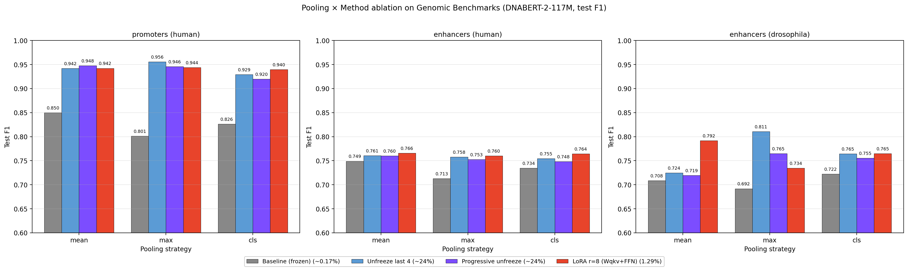

# Probing and Lightweight Fine-Tuning of DNA Foundation Models (DNABERT-2)

Course project for **CSCI 566 Deep Learning, University of Southern California (Spring 2026)**.

This repository contains the DNABERT-2 track of a group project that compared three DNA foundation models (DNABERT-2, Nucleotide Transformer, HyenaDNA) under frozen probing vs. lightweight fine-tuning. The code here covers:

- layer-wise **embedding extraction** from DNABERT-2-117M,
- **linear / MLP probing** across layers and pooling strategies,
- **LoRA fine-tuning** on three Genomic Benchmarks tasks,
- **probing a LoRA-tuned backbone** to measure how adaptation reshapes the representation,
- a **pooling × method ablation** that merges LoRA results with partial-unfreezing results.

The Nucleotide Transformer and HyenaDNA experiments were done by other team members and are not included here.

## Key findings

1. **Frozen DNABERT-2 is most useful at intermediate layers (L3–L6), not the last layer.** On `human_nontata_promoters`, the best frozen configuration is an MLP probe on layer 3 with mean pooling (macro F1 ≈ 0.91). A linear probe on the same features is ~6.5 F1 points lower: the information is there but not linearly separable.
2. **LoRA fine-tuning reverses this.** After LoRA, the best layer moves to L12 and the linear/MLP probe gap closes to ~0 — adaptation "linearizes" the task signal in the top layers.
3. **LoRA vs. partial unfreezing is a trade-off, not a clean win.** With mean pooling, LoRA (1.29% trainable params) beats unfreezing the last 4 layers (~24%) on the hardest, cross-species task (`drosophila_enhancers_stark`, F1 0.792 vs 0.724). With max pooling, partial unfreezing jumps to 0.811 and overtakes LoRA. LoRA is robust to the pooling choice; partial unfreezing is sensitive to it.
4. **Mean pooling is best in the frozen setting**, but not necessarily after fine-tuning on long sequences (drosophila sequences are ~8× longer in tokens than promoters).

### Test macro-F1, DNABERT-2-117M (held-out test set, seed 42)

| Method | Trainable | Pooling | Promoters | Enhancers (Cohn) | Enhancers (Drosophila) |
|---|---|---|---|---|---|
| Frozen baseline | ~0.17% | mean | 0.850 | 0.749 | 0.708 |
| Unfreeze last 4 | ~24% | mean | 0.942 | 0.761 | 0.724 |
| Progressive unfreeze | ~24% | mean | 0.948 | 0.760 | 0.719 |
| **LoRA r=8 (Wqkv+FFN)** | **1.29%** | mean | 0.942 | **0.766** | **0.792** |
| Unfreeze last 4 | ~24% | max | **0.956** | 0.758 | **0.811** |
| LoRA r=8 (Wqkv+FFN) | 1.29% | max | 0.944 | 0.760 | 0.734 |

Full 36-cell grid (4 methods × 3 poolings × 3 datasets): [`results/all_methods_pooling_test_summary.csv`](results/all_methods_pooling_test_summary.csv).



## Repository layout

```
notebooks/
  01_embedding_extraction.ipynb           Extract hidden states from all 13 layers (hook + repad), 3 poolings, cache as .npy
  02_linear_probe_training_v2.ipynb       Probing grid: 8 layers × 3 poolings × 3 seeds × {linear, MLP}, val-based selection
  03_lora_finetune_and_probe.ipynb        LoRA → merge_and_unload → re-extract → same probing grid (frozen vs. tuned backbone)
  03_lora_finetuning_pooling_ablation.ipynb  Main experiment: LoRA × 3 datasets × 3 poolings; final section merges with
                                          partial-unfreezing CSVs to produce the all-methods comparison figures
results/
  all_methods_pooling_test_summary.csv    36-cell ablation table (source of the figure above)
  all_methods_test_summary.csv            Mean-pooling headline table
  *.png                                   Summary figures
  <dataset>/                              Per-dataset LoRA summaries, training histories, val curves,
                                          plus <dataset>_summary.csv from the partial-unfreezing runs
  probing/                                144-run frozen probing results (probe_results_v2.csv) + layer analysis plots
  lora_then_probe/                        Frozen vs. LoRA-tuned probing heatmaps and layer curves
docs/
  566_Presentation.pdf                    Final class presentation (full group, all three models)
requirements.txt
```

## Setup

```bash
conda create -n dnabert2 python=3.10
conda activate dnabert2
pip install -r requirements.txt
```

Version pins matter: `transformers==4.40.0` and `peft==0.10.0`. Newer `peft` fails with an `EncoderDecoderCache` import error against DNABERT-2's custom modeling code. Skip the `pip install` cells inside the notebooks once the environment is set up — they will upgrade packages and break the pins.

DNABERT-2 weights are downloaded from `zhihan1996/DNABERT-2-117M` on first run (into `./dnabert2/`). No Triton / Flash Attention is required.

## Reproducing

Run the notebooks in order. Paths are relative to the notebook's directory.

| Step | Notebook | Output | Approx. time (RTX 5090) |
|---|---|---|---|
| 1 | `01_embedding_extraction` | `embedding_cache/*.npy` (86 files, ~4 GB) | 2–3 min |
| 2 | `02_linear_probe_training_v2` | `probe_results_v2.csv`, layer plots | 1–2 min (GPU or CPU) |
| 3 | `03_lora_finetune_and_probe` | `embedding_cache_lora/`, frozen-vs-LoRA heatmaps | ~20 min |
| 4 | `03_lora_finetuning_pooling_ablation` | `results/<dataset>/*_lora_*`, `results/all_methods_*` | several hours (9 LoRA runs × 15 epochs) |

Step 4's final section expects `results/<dataset>/<dataset>_summary.csv` (partial-unfreezing results) to exist; they are committed, so the comparison figures can be regenerated without re-running those experiments.

### Experiment configuration

| | Probing | LoRA fine-tuning |
|---|---|---|
| Datasets | `human_nontata_promoters` | `human_nontata_promoters`, `human_enhancers_cohn`, `drosophila_enhancers_stark` |
| Max tokens | 512 | 512 (all datasets; <4% truncation on drosophila) |
| Split | 80/20 stratified val from train, `SPLIT_SEED=42`; test reported once | same |
| Head | Linear 768→2 or MLP 768→256→32→2 | MLP 768→256→32→2 |
| LoRA | — | `target_modules=['Wqkv','gated_layers','wo']`, r=8, α=16 |
| LR | 1e-3 (Adam) | head 1e-3 / backbone 1e-4, no scheduler |
| Epochs | 10 | 15, checkpoint at best val F1 |
| Seeds | 42, 123, 456 | 42 |
| Metric | macro F1 (primary), accuracy, MCC | same |

## Implementation notes

- DNABERT-2 uses MosaicBERT-style `BertUnpadAttention`, which strips padding and flattens the batch inside the encoder, so `output_hidden_states=True` does not work. Hidden states are captured with `register_forward_hook` on `model.embeddings` and each `model.encoder.layer[i]`, then restored to `[batch, seq_len, 768]` with a `repad()` helper based on the attention mask.
- The model returns a tuple — use `outputs[0]`, not `.last_hidden_state`.
- DNABERT-2 has no `query`/`value` modules; LoRA must target `Wqkv`, `gated_layers` (GeGLU FFN) and `wo`. Targeting only `Wqkv` underperforms the frozen MLP probe.
- `genomic_benchmarks` label encoding can differ between environments; a flipped MCC sign between val and test is the symptom.

## Authors

- **Jiaxuan Cao** — embedding extraction, probing, LoRA fine-tuning, LoRA-then-probe analysis, results merging and ablation figures (notebooks 01–03; this repository)
- **Nan Huang** — partial unfreezing experiments (unfreeze-last-4 and progressive unfreezing) and the DNABERT-2 sections of the final report; her result CSVs are included under `results/<dataset>/` for the comparison
- Runpeng He, Allen Tran, Natalie Kao, Zuge Li — Nucleotide Transformer and HyenaDNA tracks

Instructor: Dr. Ruishan Liu, CSCI 566, USC.

## References

- Zhou et al., *DNABERT-2: Efficient Foundation Model and Benchmark for Multi-Species Genome* (2023)
- Hu et al., *LoRA: Low-Rank Adaptation of Large Language Models* (2021)
- Grešová et al., *Genomic Benchmarks: a collection of datasets for genomic sequence classification* (2023)
